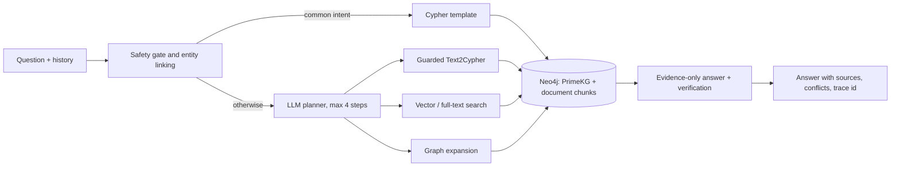

# Medical GraphRAG

Question answering over a medical knowledge graph and public health text, built to
show where graph retrieval beats pure vector retrieval — and measured on a frozen,
held-out benchmark.

> **Research demo, not medical advice.** Do not use it to diagnose, choose doses or
> make treatment decisions.

## What it does

- Answers English questions about drugs, diseases, symptoms and genes from
  [PrimeKG](https://github.com/mims-harvard/PrimeKG) in **Neo4j** (42,975 entities,
  1.72M relations) plus **MedlinePlus** summaries and **openFDA** drug labels
  (1,264 documents, 4,693 chunks).
- Routes common questions to parameterised Cypher templates; anything else goes to
  an LLM planner that chains up to four guarded tools: generated Cypher, vector
  search, full-text search and graph expansion.
- Every generated query passes a static guard, `EXPLAIN` and a read-only
  transaction. Answers are generated from retrieved evidence only, checked against
  it, and returned with sources and conflict notes.
- Understands everyday wording: brand names (*Lipitor* → atorvastatin), consumer
  terms (*high blood pressure*, *lazy eye*) and simple typos.
- Refuses crisis, dosing and diagnosis requests before any model call, while still
  answering knowledge questions that merely mention terms like *chest pain*.
- CLI, FastAPI (JSON and SSE streaming), OpenTelemetry tracing, Docker Compose and
  CI against a fictional fixture graph.

Example (not a benchmark question):

```text
$ python -m medkg.cli "Which drugs used for hypertension are contraindicated in asthma?"

The following drugs used for hypertension are contraindicated in asthma:
1. Carteolol  2. Metoprolol  3. Chlorothiazide  4. Acebutolol  5. Carvedilol
6. Betaxolol  7. Chlorthalidone  8. Bisoprolol  9. Atenolol  10. Paclitaxel
11. Hydrochlorothiazide
Count: 11 drugs
Sources: primekg

-- generated and guarded Cypher --
MATCH (d:Disease {uid:$hypertension})<-[:INDICATED_FOR]-(drug:Drug)
      -[r2:CONTRAINDICATED_FOR]->(:Disease {uid:$asthma})
RETURN DISTINCT drug.uid AS uid, drug.name AS name, r2.source AS source LIMIT 25
```

The beta-blockers are the textbook answer. Paclitaxel shows that answers inherit
the source graph's errors: PrimeKG lists it under hypertension.

## How it works



More detail: [architecture](docs/architecture.md) and the
[key decisions](docs/decisions.md#key-decisions-at-a-glance).

## Results

Frozen v2 test split, 240 questions, graph hybrid vs a pure-vector control that
retrieves from the same text plus one paragraph per entity:

| Round | Graph hybrid | Pure vector |
|---|---:|---:|
| First accepted round (2026-10-08) | 194/240 (80.8%) | 78/240 (32.5%) |
| Final round, current code (2026-10-16) | **204/240 (85.0%)** | — |

| Category (final round) | Graph hybrid | Pure vector (first round) |
|---|---:|---:|
| Single relation (36) | 97.2% | 36.1% |
| Exact counts (24) | 100% | 29.2% |
| Multi-hop chains (30) | 73.3% | 3.3% |
| Intersections / exclusions (24) | 66.7% | 8.3% |
| Brand names, lay terms, typos (36) | 69.4% | 0% |
| Safety and prompt-injection controls (30) | 100% | 96.7% |

Both rounds are scored by the same evaluator (`deterministic-3.7`). Between them,
all changes were developed on the dev split only. The LLM is the free cloud
`glm-4.5-flash` at temperature 0 with thinking off.

The gap is largest where structure matters: exact counts, intersections and
multi-hop chains such as *"Which drugs used for major depressive disorder
interact with melatonin?"* Method, per-category numbers, failure modes and
threats to validity are in [docs/evaluation.md](docs/evaluation.md).

## Quick start

Requirements: Python 3.12, Neo4j 5.26 (Docker, or a local install with JDK 21) and
an OpenAI-compatible LLM endpoint.

```bash
python -m venv .venv
source .venv/bin/activate            # Windows: .venv\Scripts\activate
pip install -e ".[dev]"
cp .env.example .env                 # set NEO4J_PASSWORD, LLM_BASE_URL, LLM_MODEL, LLM_API_KEY
docker compose up -d neo4j           # Windows without Docker: scripts/start_neo4j.ps1 -JavaHome <JDK 21>
```

Build the graph and indexes. This downloads the public sources; CSV processing and
CPU embeddings take tens of minutes.

```bash
python -m scripts.download_structured
python -m scripts.load_primekg
python -m scripts.embed_entities
python -m scripts.download_text
python -m scripts.load_text --openfda-limit 500
python -m scripts.extract_openfda --limit 80        # optional: FDA contraindication/interaction edges
python -m scripts.enrich_synonyms --apply --cached-labels   # brand and lay names (MeSH, openFDA, MedlinePlus)
python -m scripts.build_vector_corpus --threads 2   # only for the pure-vector control
```

Ask questions:

```bash
python -m medkg.cli "Which drugs used for hypertension are contraindicated in asthma?"
uvicorn medkg.api.app:app --port 8000
curl -X POST localhost:8000/ask -H "content-type: application/json" \
     -d '{"question": "What is Lipitor used for?", "history": []}'
```

`POST /ask/stream` streams the same answer as server-sent events. `GET /ready`
checks the database and LLM configuration.

### Local LLM (optional)

Any OpenAI-compatible endpoint works. To run without a cloud API, use
[Ollama](https://ollama.com) with the provided Modelfile (12k context, no
presence penalty) and set these in `.env`:

```bash
ollama pull qwen3.5:9b
ollama create medkg-qwen3.5-9b -f ollama/Modelfile
```

```text
LLM_BASE_URL=http://127.0.0.1:11434/v1
LLM_API_KEY=ollama
LLM_MODEL=medkg-qwen3.5-9b
LLM_THINKING_PARAM=reasoning_effort
LLM_COOLDOWN_S=0
```

On the v2 dev split it is about twice as fast as the cloud model and never
rate-limited, but scores lower: 77.5% vs 92.5%, mostly on multi-hop planning
([comparison](docs/evaluation.md#llm-backend-cloud-vs-local-dev-2026-10-16)).

## Evaluate

```bash
ruff check . && pytest -m "not integration"
python -m eval.run --dataset eval/datasets/structured_v2.jsonl --split dev --phase 3 --max-per-category 3
```

Datasets are generated once from the source CSV (`python -m eval.generate_v2`) and
frozen by hash. Tune on `dev`; run `test` once per system version. Integration tests
need a separate, empty Neo4j database: see `tests/integration/`.

## Repository layout

```text
src/medkg/        QA system: safety, linking, routing, planning, retrieval, answer, API, CLI
src/medkg_data/   pure transforms shared by ingestion and evaluation (CSV, ontologies, lexicon)
scripts/          downloads, graph/text import, synonym enrichment, artifact checks
eval/             black-box evaluator, scorers, dataset generators, run summaries
tests/            unit tests (no database or LLM) and integration tests
docs/             evaluation, architecture, decision log, project history
```

## Data and licences

| Source | Terms |
|---|---|
| PrimeKG | Per-source licences, including DrugBank's non-commercial terms; no data redistributed |
| MONDO | CC BY 4.0 |
| HPO | HPO attribution and integrity terms |
| MedlinePlus | NLM-authored summaries are public domain |
| openFDA | Public domain/CC0 with private-party exceptions; label text stays local |
| MeSH (NLM) | Free with attribution |
| BioRED | Research benchmark, used locally for extraction diagnostics |
| bge-small-en-v1.5 | MIT |

The code licence does not cover upstream data. See [NOTICE](NOTICE.md).

## Limitations

- The benchmark is mostly template-worded; each system version has one test round,
  and the latest round is the second use of the test split.
- Scoring checks which entities an answer names, not whether every sentence is
  true. Answers have not been reviewed by people or clinicians.
- Gold comes from PrimeKG, so it inherits that source's gaps and errors.
- Free-form generated Cypher still fails on some complex questions, and the free
  LLM endpoint used here times out and rate-limits under load. A local 9B model
  avoids that but plans multi-hop questions much worse.

## Documentation

- [Evaluation: method and results](docs/evaluation.md)
- [Architecture](docs/architecture.md)
- [Decision log](docs/decisions.md) — start with the table at the top
- [Project history](docs/history/README.md) — process reports; the Chinese prototype is tag `zh-v2`
