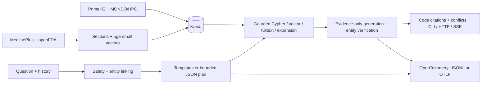

# English Medical GraphRAG

An English research demo combining a bounded medical graph, public health
summaries and drug-label evidence. CLI, FastAPI, verified-answer SSE, independent
evaluation and OpenTelemetry are included. **Not medical advice or a clinically
validated system.** The Chinese implementation is preserved by the local `zh-v2` tag.



See [architecture](docs/architecture.md), [decisions](docs/decisions.md) and
[measured results](docs/reports/summary.md).

## Quick start

Requires Python 3.12 and Neo4j Community 5.26 with JDK 21. Use a project environment.
The existing checkout is `E:\medical project\medical-kg-qa`; keep data and caches
inside it. Normal use of the delivered checkout does not require another import.

```powershell
cd 'E:\medical project\medical-kg-qa'
# Create only if .venv is absent:
py -3.12 -m venv .venv
$env:TEMP = Join-Path (Get-Location) '.cache\temp'
$env:TMP = $env:TEMP
$env:PIP_CACHE_DIR = Join-Path (Get-Location) '.cache\pip'
$env:HF_HOME = Join-Path (Get-Location) '.cache\huggingface'
New-Item -ItemType Directory -Force -Path $env:TEMP | Out-Null
.\.venv\Scripts\python.exe -m pip install -e '.[dev]'
```

Configure the variables in `.env.example` in an ignored `.env`. Settings check the
repository, then its parent `.env`, without overriding environment variables.
Reuse your OpenAI-compatible endpoint/model; thinking stays disabled. `JUDGE_MODEL`
defaults to `LLM_MODEL`. Never commit credentials.

Start the existing Windows Neo4j installation in another terminal:

```powershell
# Specify another JDK 21 path if needed; no global PATH change:
.\scripts\start_neo4j.ps1 -JavaHome 'D:\PyCharm 2025.2\jbr'
```

For a **fresh, dedicated database**, import in this order. Downloaders cache raw
snapshots. CSV processing and CPU embeddings can take tens of minutes or longer;
check available disk space first. Do not run the importer against unrelated data.

```powershell
.\.venv\Scripts\python.exe -m scripts.download_structured
.\.venv\Scripts\python.exe -m scripts.load_primekg
.\.venv\Scripts\python.exe -m scripts.embed_entities
.\.venv\Scripts\python.exe -m scripts.download_text
.\.venv\Scripts\python.exe -m scripts.load_text --openfda-limit 500
.\.venv\Scripts\python.exe -m eval.biored --limit 12
.\.venv\Scripts\python.exe -m scripts.extract_openfda --limit 80
.\.venv\Scripts\python.exe -m scripts.embed_entities
.\.venv\Scripts\python.exe -m scripts.build_vector_corpus --threads 2
```

The openFDA request ledger caps the whole task at 500, including failed requests.
A cached import does not authorize another 500. Extraction links existing entities
only and creates a review queue. Recorded snapshots/hashes define the reported run;
new upstream versions may change counts.

```powershell
.\.venv\Scripts\python.exe -m medkg.cli 'Which genes are associated with asthma?' --json
.\.venv\Scripts\python.exe -m uvicorn medkg.api.app:app --host 127.0.0.1 --port 8000
```

POST `/ask` accepts `{"question":"Which genes are associated with asthma?","history":[]}`.
POST `/ask/stream` accepts the same body and emits `status`, verified final `answer`
chunks, then `result` events. GET `/health` checks liveness; GET `/ready` checks graph
connectivity and LLM configuration without a provider call. Readiness does not
establish provider availability. History is limited to four turns.

Compose defines `neo4j:5.26-community` and app, with health checks and loopback
published ports. `docker compose up --build` requires Docker and pulls images;
no image was pulled in this task. Its new Neo4j volume needs an explicit import.
Linux bind mounts must permit container uid 10001 to write caches and logs.

## Evaluation and checks

```powershell
.\.venv\Scripts\ruff.exe check .
.\.venv\Scripts\python.exe -m pytest -m 'not integration'
$env:MEDKG_INTEGRATION='1'
$env:MEDKG_REAL_COUNTS='1'
.\.venv\Scripts\python.exe -m pytest -m integration
# Use dev while changing rules/prompts:
.\.venv\Scripts\python.exe -m eval.run --dataset eval/datasets/structured_v2.jsonl --split dev --phase 3 --max-per-category 3
# Offline readiness check for the new human-authored packet (initially blocked):
.\.venv\Scripts\python.exe -m eval.independent check --packet .cache/next-round-2026-10-08/independent-evaluation --queue eval/human_labels/independent_2026_10_08_authoring_todo.jsonl
```

Evaluation calls the public process boundary; `eval/` does not import QA internals.
Gold comes from CSV. Raw/derived datasets, per-question records and human queues
are ignored. Public text drafts, MANIFEST and aggregates are committed. CI uses a
fictional fixture graph and FakeLLM with no real LLM or embedding-model download.
The default synthetic loader requires an empty/fixture-only database.
Preserve the frozen v1/v2 datasets and historical test runs. The next held-out
evaluation follows the [independent authoring protocol](docs/evaluation/independent-evaluation.md)
after human authoring, source review and finite run/budget registration.

## Measured outcomes

| Frozen v2 test scope | Questions | Hybrid | Pure vector |
|---|---:|---:|---:|
| All cases, one accepted round | 240 | **194/240 (80.83%)** | 78/240 (32.50%) |
| Same cases with no API error in either system | 233 | **194/233 (83.26%)** | 76/233 (32.62%) |

- One accepted round per system, scored by `deterministic-3.5`; four API-invalid
  attempts are retained locally. The accepted hybrid has seven API-error questions,
  vector zero. Both use the same 60-second timeout and two-second cooldown.
- Hybrid passes all 30 safety/adversarial controls. Vector fails one adversarial
  control (`v2-0373`) that hybrid passes; it is not an approved fallback.
- Lexical variation remains weak: hybrid 17/36, vector 0/36 despite the synonym
  rebuild. Both falsely refuse 1/12 sensitive-term knowledge questions.
- V2 is mostly template-based, with small subgroups and unreviewed human queues.
  Long-list scoring does not measure full recall. These are knowledge-benchmark
  results, without clinical validation.

The [v2 report](docs/reports/v2-results.md) records categories, lexical coverage,
paired exclusions, latency, all-attempt token accounting, frozen hashes and limits.
This table describes the snapshot before the subsequent
[T5 improvements](docs/reports/t5-improvements.md). Those changes add cached-source
aliases, narrow population refusals, normalize planner booleans and pace transient
provider failures; their checks use dev only, without a new held-out test score.

The [subsequent follow-up](docs/reports/next-round-2026-10-08.md) adds bounded typo
handling and a read-only alias audit. A complete 160-case hybrid dev run passes
140/160 (87.50%), including 10/10 typo and 20/20 safety/adversarial cases, with five
API timeouts and six query-syntax errors. Ruff, 412 non-integration tests and all
15 integration tests pass. The new 100-slot independent evaluation packet awaits
human authoring/review; these dev results do not replace the frozen test table.

The user-authorized [AI source review](docs/reports/ai-review-2026-10-09.md) checks
100 priority alias pairs (6 supported, 28 unsupported, 66 uncertain) and audits
12 AI-authored source-grounded pilot questions. Three agents preserve separate
AI provenance and the original human queues. Reviewer agreement is not accuracy;
synthetic probes also expose semantic and safety-scoring limits. No catalog changes
or new system performance measurements result from this review.

The [October 15 implementation](docs/reports/review-implementation-2026-10-15.md)
adds reversible query-time quarantine for the 28 conflicting mappings, complete
mixed-graph coverage checks, bounded full-answer safety diagnostics, reproducible
evidence checks and offline blinded review tools. Automatic entity support is
explicitly separated from unevaluated semantic support. The historical results
above retain their original scorer; no new held-out score is claimed.
The subsequent [independent review and repairs](docs/reports/independent-review-2026-10-15.md)
close evidence-dispatch, quotation, citation-masking and audit-fingerprint gaps.
Scorer `deterministic-3.7` remains a bounded diagnostic, without new benchmark results.

Historical v1 results use different cases/scoring and are not a matched v2
baseline: the offline `deterministic-3.4` rescoring of earlier saved answers gives
87.50% for improved hybrid and 56.67% for vector on 240 cases. Earlier sampled,
text and staged results remain in the [delivery summary](docs/reports/summary.md),
[follow-up report](docs/reports/followup-2026-10-06.md) and
[implementation report](docs/reports/improvement-2026-10-06.md).

## Data licensing

| Source | Rights/use boundary |
|---|---|
| PrimeKG | Source-specific licenses, including DrugBank commercial restrictions; no descriptions or derived data distributed |
| MONDO | CC BY 4.0; attribution required |
| HPO | HPO attribution/integrity terms; version-specific conditions in NOTICE |
| MedlinePlus | NLM-authored summaries are public domain; linked third-party material excluded |
| openFDA | Government/CC0 terms include private-party copyright exceptions; labels stay local |
| MeSH (NLM) | Free with attribution; drug brand/synonym and lay disease aliases, not distributed |
| DrugBank Vocabulary | Optional CC0 synonyms, manual download only |
| BioRED | Research benchmark; original abstract rights remain; local diagnostic only |
| bge-small-en-v1.5 | MIT model license; weights not distributed |

See [NOTICE](NOTICE.md) for official links and conditions. The software license
does not grant rights to upstream medical data.

## Limits and human review

The frozen v2 corpus has 400 structured questions (160 dev / 240 test), with
28 validated LLM rewordings; most retain template wording or unchanged LLM returns.
The earlier v1 set had 24 paraphrases. Text drafts are
40 text-only and 40 mixed. Only 19 passed the bounded LLM drafting/grounding step;
fallbacks are disclosed. All 80 remain `draft`.

Review 100 sentence claims in `eval/human_labels/judge_calibration_todo.jsonl`,
30 assertions in `eval/human_labels/extraction_review_todo.jsonl`, and all 80 text
drafts. The [review guide](eval/human_labels/README.md) explains annotation and
agreement calculation. Judge labels remain **uncalibrated** until human comparison.
Also review the 18 quarantined legacy assertions in
`eval/human_labels/extraction_repair_review_todo.jsonl`; these are absent from the
current graph. Original queues remain historical review artifacts.

Known-entity verification does not prove sentence truth. Language and output-safety
gates are conservative regex rules, not complete classifiers. ANN filtering,
two-hop/row/evidence bounds and the 512-token embedding window limit recall. The
pure-vector corpus includes all 42,975 entity paragraphs and 4,693 chunks; long
paragraphs are embedded by their prefix. No result establishes clinical usefulness
or production security. Docker build, remote CI and Phoenix were not exercised locally.

Default SDK spans write metadata-only `runs/traces/*.jsonl`. Optional OTLP HTTP
and Phoenix viewing are documented in [architecture](docs/architecture.md).
Question/evidence content and credentials are excluded from telemetry.

**Do not use this demo to diagnose, prescribe, choose doses or make treatment
decisions. Seek a qualified clinician for individual medical care.**
