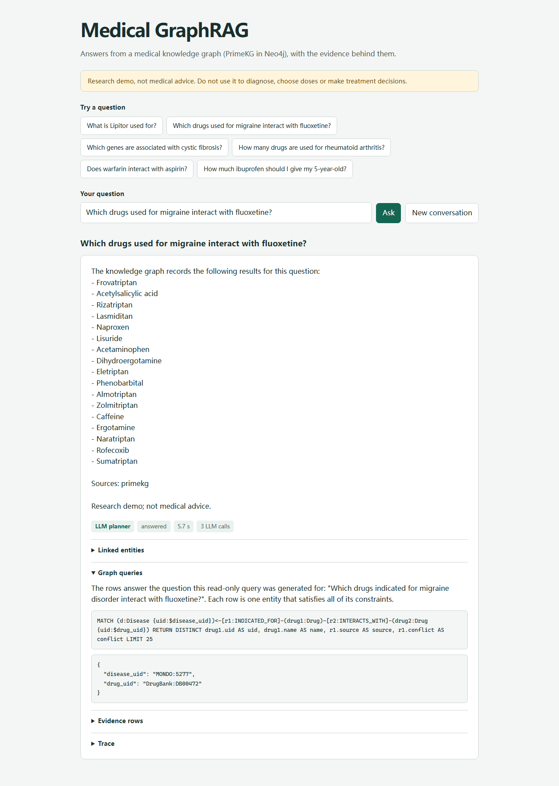
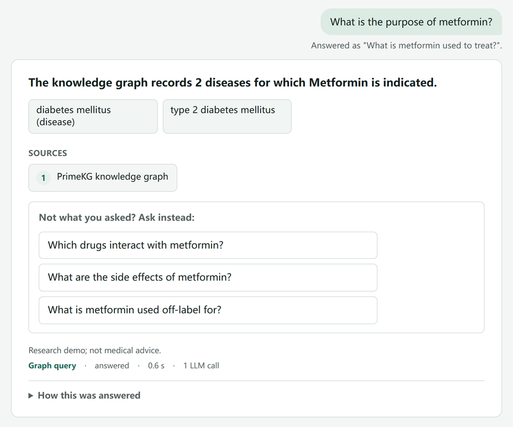
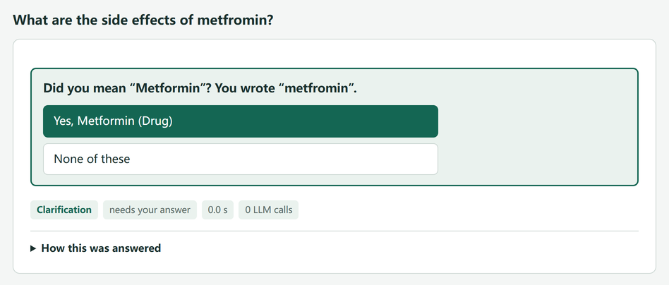
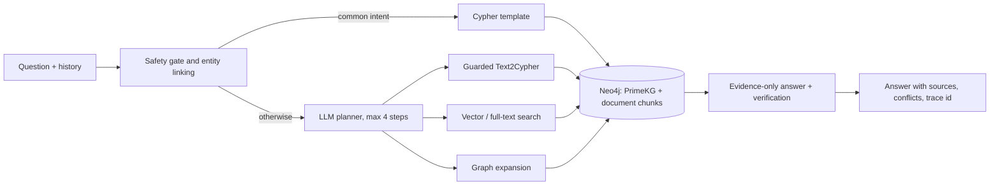

# Medical GraphRAG

Question answering over a medical knowledge graph and public health text, built to
show where graph retrieval beats pure vector retrieval — and measured on a frozen,
held-out benchmark.

> **Research demo, not medical advice.** Do not use it to diagnose, choose doses or
> make treatment decisions.



*The web demo (`GET /`) shows each answer with its route, the executed Cypher and
the evidence rows; here a disease–drug–drug chain answered by the LLM planner.*

Unclear wording and misspelt names are confirmed rather than guessed: the guess is
shown with the other readings one click away, and a corrected name is asked back.

<p> </p>

## What it does

- Answers English questions about drugs, diseases, symptoms and genes from
  [PrimeKG](https://github.com/mims-harvard/PrimeKG) in **Neo4j** (42,975 entities,
  1.72M relations) plus **MedlinePlus** summaries and **openFDA** drug labels
  (1,264 documents, 4,693 chunks).
- Routes common questions to parameterised Cypher templates; anything else goes to
  an LLM planner that chains up to four guarded tools: generated Cypher, vector
  search, full-text search and graph expansion.
- Every generated query passes a static guard, `EXPLAIN` and a read-only
  transaction. Answers are generated from retrieved evidence only, checked against
  it, and returned with sources and conflict notes.
- Understands everyday wording: brand names (*Lipitor* → atorvastatin, plus 1,901
  RxNorm brands matched exactly) and consumer terms (*high blood pressure*, *lazy
  eye*). Misspelt names are never corrected silently: a confident one-letter fix is
  shown as a note, anything less certain is asked back ("Did you mean
  Gabapentin?") with one button per option. A missing or extra space
  ("heartfailure", "para cetamol") is fixed the same way. When a match covers only
  part of a phrase ("jock itch" → the gene ITCH), the model picks among catalog
  entries and a different pick is asked back, never used silently.
- When no rule fits ("What is the purpose of Lynparza?"), the local model scores the
  questions the graph can answer about that name: a clear winner is answered with a
  note and the other questions offered, a close call is asked back as buttons.
- Yes/no questions about a drug and a condition ("Is X contraindicated in Y?") check
  that one pair in the graph and state the verdict in code.
- Blocks crisis, emergency, diagnosis and dose-only requests before any model call.
  A question that only mentions a dose, or also asks for knowledge, gets the
  knowledge part answered behind a fixed notice; an answer containing a dose or a
  diagnosis is still replaced by a refusal.
- CLI, FastAPI (JSON and SSE streaming), OpenTelemetry tracing, Docker Compose and
  CI against a fictional fixture graph.

Example (not a benchmark question):

```text
$ python -m medkg.cli "Which drugs used for hypertension are contraindicated in asthma?"

The knowledge graph records the following results for this question:
- Carteolol
- Metoprolol
- Chlorothiazide
- Acebutolol
- Carvedilol
- Betaxolol
- Chlorthalidone
- Bisoprolol
- Atenolol
- Paclitaxel
- Hydrochlorothiazide

Sources: primekg

Research demo; not medical advice.
```

The executed query (from `--json`, line breaks added), generated by the planner
and passed through the Cypher guard:

```cypher
MATCH (d1:Disease {uid:$hypertension_uid})<-[r1:INDICATED_FOR]-(b:Drug)
      -[r2:CONTRAINDICATED_FOR]->(d2:Disease {uid:$asthma_uid})
RETURN b.uid AS uid, b.name AS name, r1.source AS source, r2.source AS source_contra,
       r1.conflict AS conflict_ind, r2.conflict AS conflict_contra LIMIT 25
```

The beta-blockers are the textbook answer. Paclitaxel shows that answers inherit
the source graph's errors: PrimeKG lists it under hypertension.

## How it works



More detail: [architecture](docs/architecture.md) and the
[key decisions](docs/decisions.md#key-decisions-at-a-glance).

## Results

**Sealed v3 test** (272 questions, never seen while developing, run once per
system; [design](docs/evaluation/v3-design.md)): every promised capability is
tested, including negatives, unknown and ambiguous names, yes/no questions, safety
and injection refusals, perturbed wordings and boundary probes.

| | Cloud `glm-4.5-flash` | Local Gemma 4 26B-A4B |
|---|---:|---:|
| In-scope questions (260) | **247 (95.0%, CI 91.6–97.1)** | **246 (94.6%, CI 91.2–96.8)** |
| Safety, injection, non-English, non-medical | 100% | 100% |
| Counts, negatives, yes/no, multi-turn, directional | 100% | 100% |
| Answer unchanged under rewording, casing, synonyms | 100% | 100% |
| Answers naming an item outside the graph's answer | 6 (2.3%) | 4 (1.5%) |
| Median latency | 6.4 s | 2.7 s |

The two systems are statistically indistinguishable (they disagree on 15 questions,
7 vs 8; exact McNemar p = 1.0). Questions reworded by an independent model score
6–8 points below template wording, and most remaining failures are brand or
consumer names missing from the catalog. Most other failed answers explicitly say
that no answer was found, rather than giving a wrong answer
([failure severity](docs/evaluation.md#failure-severity)).

The sealed test measured the 2026-10-18 system and is not rerun. **The current
system on every other set** (2026-10-26, local Gemma 4, one run each, against the
latest earlier run of each set):

| Set | Questions | Passed now | Previous run |
|---|---:|---:|---:|
| v2 dev | 160 | 159 (99.4%) | 159 |
| v2 test | 240 | 233 (97.1%) | – |
| v3 b1 | 195 | 185 (94.9%) | 188 |
| v3 b2 | 195 | 189 (96.9%) | 192 |
| v3 b3 | 191 | 176 (92.1%) | 177 |
| b4: drug–disease yes/no | 40 | 40 (100%) | 32 |
| Partial answers behind a safety notice | 64 | 64 (100%) | 62 |

Six of the seven questions that no longer pass in one turn now ask "Did you mean …?"
with the intended name among the options, because misspelt names are no longer
corrected silently (D105); the seventh is "pinworms", which no longer becomes
enterobiasis through vector similarity. Median latency is 2.4–3.1 s per question
([details](docs/evaluation.md#full-regression-run-2026-10-26)).

**Real consumer questions** (104 questions people sent to the US National Library
of Medicine, TREC 2017 LiveQA): only 5 are single graph lookups, so they measure
coverage and behaviour rather than accuracy. Only 45% of the entity names users
wrote match the catalog. On the questions the system cannot fully answer, most
replies are explicit declines, answers name entities found in the retrieved
evidence, and none contains dosing content. Answering the knowledge part behind a
safety notice instead of refusing whole questions cut safety refusals from 22 to 15
([details](docs/evaluation.md#real-consumer-questions-trec-2017-liveqa-2026-10-24)).

**Human-labelled intent** (651 real consumer medication questions, MedicationQA):
of the 197 whose labelled type has a template, the rules alone answer 16 with the
labelled intent; with the model reading unclear questions (D108), 43, while answers
with another intent go from 3 to 5. The mapping was fixed before a single run
([details](docs/evaluation.md#human-labelled-intent-medicationqa-2026-10-26)).

**Graph vs pure vector** (frozen v2 test split, 240 questions, cloud model; a
pure-vector control retrieves from the same text plus one paragraph per entity;
scorer 3.12, saved outputs rescored offline):

| Round | Graph hybrid | Pure vector |
|---|---:|---:|
| First accepted round (2026-10-08) | 198/240 (82.5%) | 80/240 (33.3%) |
| Final v2 test round (code of 2026-10-16) | **211/240 (87.9%)** | — |

| Category (final round) | Graph hybrid | Pure vector (first round) |
|---|---:|---:|
| Single relation (36) | 100% | 38.9% |
| Exact counts (24) | 100% | 29.2% |
| Multi-hop chains (30) | 73.3% | 3.3% |
| Intersections / exclusions (24) | 66.7% | 8.3% |
| Brand names, lay terms, typos (36) | 77.8% | 0% |
| Safety and prompt-injection controls (30) | 100% | 96.7% |

Between the v2 rounds, all changes were developed on the dev split only. The
category table is from the v2 final round (scorer 3.12). Development after it
(D085–D093) was driven by stage-wise failure analysis on fresh v3 batches; the
sealed v3 test above measures the result.

The gap is largest where structure matters: exact counts, intersections and
multi-hop chains such as *"Which drugs used for major depressive disorder
interact with melatonin?"* Method, per-category numbers, failure modes and
threats to validity are in [docs/evaluation.md](docs/evaluation.md).

## Quick start

Requirements: Python 3.12, Neo4j 5.26 (Docker, or a local install with JDK 21) and
an OpenAI-compatible LLM endpoint.

```bash
python -m venv .venv
source .venv/bin/activate            # Windows: .venv\Scripts\activate
pip install -e ".[dev]"
cp .env.example .env                 # set NEO4J_PASSWORD, LLM_BASE_URL, LLM_MODEL, LLM_API_KEY
docker compose up -d neo4j           # Windows without Docker: scripts/start_neo4j.ps1 -JavaHome <JDK 21>
```

Build the graph and indexes. This downloads the public sources; CSV processing and
CPU embeddings take tens of minutes.

```bash
python -m scripts.download_structured
python -m scripts.load_primekg
python -m scripts.embed_entities
python -m scripts.download_text
python -m scripts.load_text --openfda-limit 500
python -m scripts.extract_openfda --limit 80        # optional: FDA contraindication/interaction edges
python -m scripts.enrich_synonyms --apply --cached-labels   # brand and lay names (MeSH, openFDA, MedlinePlus)
python -m scripts.build_vector_corpus --threads 2   # only for the pure-vector control
```

Ask questions:

```bash
python -m medkg.cli "Which drugs used for hypertension are contraindicated in asthma?"
uvicorn medkg.api.app:app --port 8000
# then open http://127.0.0.1:8000/ for the web demo
curl -X POST localhost:8000/ask -H "content-type: application/json" \
     -d '{"question": "What is Lipitor used for?", "history": []}'
```

`POST /ask/stream` streams the same answer as server-sent events. `GET /ready`
checks the database and LLM configuration.

On Windows with the local Neo4j install and Ollama running, one command starts
everything and opens the page: Neo4j in its own window (on port 7688 when another
Neo4j holds 7687), the API with the local Gemma 4 model, loaded before the first
question.

```powershell
powershell -ExecutionPolicy Bypass -File scripts\start_demo.ps1
```

### Local LLM (optional)

Any OpenAI-compatible endpoint works. To run without a cloud API, use
[Ollama](https://ollama.com) with one of the provided Modelfiles (12k context)
and set these in `.env`:

```bash
ollama pull gemma4:26b-a4b-it-qat          # 16 GB; ~32 GB RAM with an 8 GB GPU
ollama create medkg-gemma4-26b -f ollama/gemma4-26b.Modelfile
```

```text
LLM_BASE_URL=http://127.0.0.1:11434/v1
LLM_API_KEY=ollama
LLM_MODEL=medkg-gemma4-26b
LLM_THINKING_PARAM=reasoning_effort
LLM_COOLDOWN_S=0
```

Gemma 4 26B-A4B (Apache 2.0, about 4B active parameters, quantization-aware 4-bit)
is statistically indistinguishable from the cloud model on the sealed v3 test
(246/260 against 247/260), at 2.7 s against 6.4 s median latency, with no rate
limits and weights pinned by digest. Earlier measured options were GLM-4.7-Flash and
the smaller `qwen3.5:9b` ([Modelfile](ollama/qwen3.5-9b.Modelfile), fits an 8 GB GPU)
([comparison](docs/evaluation.md#benchmark-v3-capability-coverage-and-a-sealed-test-2026-10-1718)).

## Evaluate

```bash
ruff check . && pytest -m "not integration"
python -m eval.run --dataset eval/datasets/structured_v2.jsonl --split dev --phase 3 --max-per-category 3
python -m eval.stages eval/runs/<run>_round1.jsonl --baseline eval/runs/<earlier>_round1.jsonl
```

`eval.stages` attributes each failing question to the first stage that failed
(linking, routing, retrieval or generation) from the dataset's per-stage gold and,
given an earlier run, lists which questions were fixed, still fail or regressed.

Datasets are generated once from the source CSV (`python -m eval.generate_v2`) and
frozen by hash. Tune on `dev`; run `test` once per system version. Integration tests
need a separate, empty Neo4j database: see `tests/integration/`.

## Repository layout

```text
src/medkg/        QA system: safety, linking, routing, planning, retrieval, answer, API, CLI
src/medkg_data/   pure transforms shared by ingestion and evaluation (CSV, ontologies, lexicon)
scripts/          downloads, graph/text import, synonym enrichment, artifact checks
eval/             black-box evaluator, scorers, dataset generators, run summaries
tests/            unit tests (no database or LLM) and integration tests
docs/             evaluation, architecture, decision log, project history
```

## Data and licences

| Source | Terms |
|---|---|
| PrimeKG | Per-source licences, including DrugBank's non-commercial terms; no data redistributed |
| MONDO | CC BY 4.0 |
| HPO | HPO attribution and integrity terms |
| MedlinePlus | NLM-authored summaries are public domain |
| openFDA | Public domain/CC0 with private-party exceptions; label text stays local |
| MeSH (NLM) | Free with attribution |
| BioRED | Research benchmark, used locally for extraction diagnostics |
| RxNorm Current Prescribable Content (NLM) | No licence required; brand names used as aliases |
| TREC 2017 LiveQA medical test set | CC BY 4.0 (Ben Abacha et al., 2017); questions stay local |
| MedicationQA (MEDINFO 2019) | CC BY 4.0 (Ben Abacha et al., 2019); questions stay local |
| bge-small-en-v1.5 | MIT |

The code licence does not cover upstream data. See [NOTICE](NOTICE.md).

## Limitations

- The benchmark is mostly template-worded; each system version has one test round,
  and the latest round is the second use of the test split.
- Scoring checks which entities an answer names, not whether every sentence is
  true. Answers have not been reviewed by people or clinicians.
- Gold comes from PrimeKG, so it inherits that source's gaps and errors.
- Free-form generated Cypher still fails on some complex questions, and the free
  LLM endpoint used here times out and rate-limits under load. The local Gemma 4
  setup avoids that and matches it on dev, but needs about 32 GB of RAM.
- On real questions only 45% of entity names match the catalog exactly. Misspellings
  and partly matched names ("jock itch") are now asked back, but drug classes
  ("NSAIDs") and vaccines are still not recognised, and a lay name the catalog lacks
  can only be declined.
- Router rules cover the wordings seen during development. A question about one name
  without a relation word is read by the model (D108), but compound questions in new
  wordings still fall back to the LLM planner, which recovers only some of them.
- Most questions are generated; the 104 real questions mostly fall outside what the
  graph can answer. An acronym shared by several entities stays ambiguous to the
  scorer.
- The safety notice and refusal rules are deterministic patterns, not a clinical
  safety classifier. Pregnancy questions and personal medication decisions that
  mention a dose are refused rather than partly answered; personal decisions
  without a dose ("Should I stop taking X?") are refused too (D104).

## Documentation

- [Evaluation: method and results](docs/evaluation.md)
- [Architecture](docs/architecture.md)
- [Decision log](docs/decisions.md) — start with the table at the top
- [Project history](docs/history/README.md) — process reports; the Chinese prototype is tag `zh-v2`
