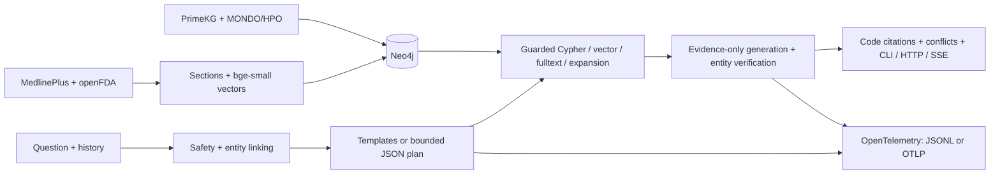

# English Medical GraphRAG

An English research demo combining a bounded medical graph, public health
summaries and drug-label evidence. CLI, FastAPI, verified-answer SSE, independent
evaluation and OpenTelemetry are included. **Not medical advice or a clinically
validated system.** The Chinese implementation is preserved by the local `zh-v2` tag.



See [architecture](docs/architecture.md), [decisions](docs/decisions.md) and
[measured results](docs/reports/summary.md).

## Quick start

Requires Python 3.12 and Neo4j Community 5.26 with JDK 21. Use a project environment.
The existing checkout is `E:\medical project\medical-kg-qa`; keep data and caches
inside it. Normal use of the delivered checkout does not require another import.

```powershell
cd 'E:\medical project\medical-kg-qa'
# Create only if .venv is absent:
py -3.12 -m venv .venv
$env:TEMP = Join-Path (Get-Location) '.cache\temp'
$env:TMP = $env:TEMP
$env:PIP_CACHE_DIR = Join-Path (Get-Location) '.cache\pip'
$env:HF_HOME = Join-Path (Get-Location) '.cache\huggingface'
New-Item -ItemType Directory -Force -Path $env:TEMP | Out-Null
.\.venv\Scripts\python.exe -m pip install -e '.[dev]'
```

Configure the variables in `.env.example` in an ignored `.env`. Settings check the
repository, then its parent `.env`, without overriding environment variables.
Reuse your OpenAI-compatible endpoint/model; thinking stays disabled. `JUDGE_MODEL`
defaults to `LLM_MODEL`. Never commit credentials.

Start the existing Windows Neo4j installation in another terminal:

```powershell
# Specify another JDK 21 path if needed; no global PATH change:
.\scripts\start_neo4j.ps1 -JavaHome 'D:\PyCharm 2025.2\jbr'
```

For a **fresh, dedicated database**, import in this order. Downloaders cache raw
snapshots. CSV processing and CPU embeddings can take tens of minutes or longer;
check available disk space first. Do not run the importer against unrelated data.

```powershell
.\.venv\Scripts\python.exe -m scripts.download_structured
.\.venv\Scripts\python.exe -m scripts.load_primekg
.\.venv\Scripts\python.exe -m scripts.embed_entities
.\.venv\Scripts\python.exe -m scripts.download_text
.\.venv\Scripts\python.exe -m scripts.load_text --openfda-limit 500
.\.venv\Scripts\python.exe -m eval.biored --limit 12
.\.venv\Scripts\python.exe -m scripts.extract_openfda --limit 80
.\.venv\Scripts\python.exe -m scripts.embed_entities
.\.venv\Scripts\python.exe -m scripts.build_vector_corpus --threads 2
```

The openFDA request ledger caps the whole task at 500, including failed requests.
A cached import does not authorize another 500. Extraction links existing entities
only and creates a review queue. Recorded snapshots/hashes define the reported run;
new upstream versions may change counts.

```powershell
.\.venv\Scripts\python.exe -m medkg.cli 'Which genes are associated with asthma?' --json
.\.venv\Scripts\python.exe -m uvicorn medkg.api.app:app --host 127.0.0.1 --port 8000
```

POST `/ask` accepts `{"question":"Which genes are associated with asthma?","history":[]}`.
POST `/ask/stream` accepts the same body and emits `status`, verified final `answer`
chunks, then `result` events. GET `/health` checks liveness; GET `/ready` checks graph
connectivity and LLM configuration without a provider call. Readiness does not
establish provider availability. History is limited to four turns.

Compose defines `neo4j:5.26-community` and app, with health checks and loopback
published ports. `docker compose up --build` requires Docker and pulls images;
no image was pulled in this task. Its new Neo4j volume needs an explicit import.
Linux bind mounts must permit container uid 10001 to write caches and logs.

## Evaluation and checks

```powershell
.\.venv\Scripts\ruff.exe check .
.\.venv\Scripts\python.exe -m pytest -m 'not integration'
$env:MEDKG_INTEGRATION='1'
$env:MEDKG_REAL_COUNTS='1'
.\.venv\Scripts\python.exe -m pytest -m integration
# Generate local CSV gold only if absent; preserve the frozen MANIFEST:
.\.venv\Scripts\python.exe -m eval.generate --paraphrase-limit 24
# Use dev while changing rules/prompts:
.\.venv\Scripts\python.exe -m eval.run --split dev --phase 3 --max-per-category 3
# Three-round fixed-sample gate after development:
.\.venv\Scripts\python.exe -m eval.run --split test --rounds 3 --phase 3 --max-per-category 3 --output eval/runs/recheck_summary.json --baseline eval/runs/v1_summary.json --fail-on-redline-regression
```

Evaluation calls the public process boundary; `eval/` does not import QA internals.
Gold comes from CSV. Raw/derived datasets, per-question records and human queues
are ignored. Public text drafts, MANIFEST and aggregates are committed. CI uses a
fictional fixture graph and FakeLLM with no real LLM or embedding-model download.
The default synthetic loader requires an empty/fixture-only database.

## Measured outcomes

These are sampled results, not full-test estimates. All models use the same 54/240
structured test questions, three rounds and cache off. The sample overweights
safety/adversarial cases: all 30 such cases, three per other category.

| Archived stage/model | Mean pass | Population std | Redline regressions |
|---|---:|---:|---:|
| Phase 2: v0 structured | 74.07% | 1.51 pp | Baseline |
| Phase 3: v1 hybrid | 70.37% | 0.00 pp | 0 |
| Phase 3: pure vector | 38.89% | 0.00 pp | 13; gate exit 1 |
| Phase 4: hybrid delivery | 70.99% | 0.87 pp | 0 against v1 |

**v1 did not improve the overall sampled structured score over v0.** The vector
control fails the redline gate and is not an approved fallback. The baseline already
has one failing adversarial case; a no-regression gate does not mean every attack
passes. Engineering changes are measured separately in [phase 4](docs/reports/phase-4.md).

Text measurements use the same 8/48 draft test questions, three rounds: hybrid
12.50% (std 0.00 pp), vector 45.83% (std 5.89 pp). Strict quote coverage can reject
correct paraphrases. These unreviewed, small-sample scores are exploratory.
BioRED uses 12 sampled test abstracts: pair F1 0.3467, native typed F1 0.1067.
FDA extraction produced 45 assertions from 80/592 eligible chunks, with 75.56%
PrimeKG agreement; agreement is not medical truth.

## Data licensing

| Source | Rights/use boundary |
|---|---|
| PrimeKG | Source-specific licenses, including DrugBank commercial restrictions; no descriptions or derived data distributed |
| MONDO | CC BY 4.0; attribution required |
| HPO | HPO attribution/integrity terms; version-specific conditions in NOTICE |
| MedlinePlus | NLM-authored summaries are public domain; linked third-party material excluded |
| openFDA | Government/CC0 terms include private-party copyright exceptions; labels stay local |
| BioRED | Research benchmark; original abstract rights remain; local diagnostic only |
| bge-small-en-v1.5 | MIT model license; weights not distributed |

See [NOTICE](NOTICE.md) for official links and conditions. The software license
does not grant rights to upstream medical data.

## Limits and human review

The corpus has 400 structured questions (160 dev / 240 test), but only 24 were
LLM-paraphrased; others use declared template/authored wording. Text drafts are
40 text-only and 40 mixed. Only 19 passed the bounded LLM drafting/grounding step;
fallbacks are disclosed. All 80 remain `draft`.

Review 100 sentence claims in `eval/human_labels/judge_calibration_todo.jsonl`,
30 assertions in `eval/human_labels/extraction_review_todo.jsonl`, and all 80 text
drafts. The [review guide](eval/human_labels/README.md) explains annotation and
agreement calculation. Judge labels remain **uncalibrated** until human comparison.

Known-entity verification does not prove sentence truth. Language and output-safety
gates are conservative regex rules, not complete classifiers. ANN filtering,
two-hop/row/evidence bounds and the 512-token embedding window limit recall. The
pure-vector corpus includes all 42,975 entity paragraphs and 4,693 chunks; long
paragraphs are embedded by their prefix. No result establishes clinical usefulness
or production security. Docker build, remote CI and Phoenix were not exercised locally.

Default SDK spans write metadata-only `runs/traces/*.jsonl`. Optional OTLP HTTP
and Phoenix viewing are documented in [architecture](docs/architecture.md).
Question/evidence content and credentials are excluded from telemetry.

**Do not use this demo to diagnose, prescribe, choose doses or make treatment
decisions. Seek a qualified clinician for individual medical care.**
