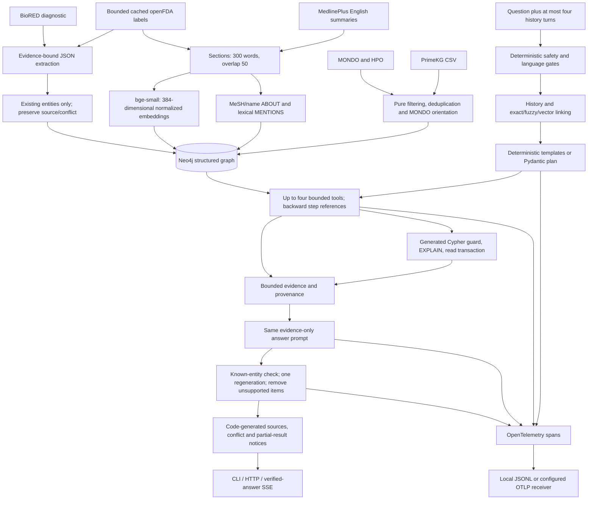

# Architecture

The public boundary is `ask(question, history) -> answer, contexts, route, cypher,
trace_id`, with additional usage, safety, execution and failure metadata. CLI,
HTTP and SSE call the same pipeline. Evaluation uses an external JSON-lines
process protocol and independently normalizes entity names and query results.



## Data boundary and identity

Nodes are Disease, Drug, Phenotype, Gene, Document and Chunk. Every label has a
unique `uid` constraint and English fulltext index. `chunk_embedding` is a
384-dimensional cosine index; `ft_chunk_text` additionally indexes chunk text.
The CSV selects nine relation families. Each retained edge identifies its source;
TARGETS also includes its original display relation as `kind`. Undirected drug
pairs are stored once in uid order. Disease hierarchy includes only direct,
current MONDO `is_a` links with known direction. Drug/disease descriptive fields
from PrimeKG are never loaded.

`medkg_data` is a pure CSV/OBO transformation package shared by ingestion and
question generation. Neither generator gold nor independent scores read QA
internals. Structural gold is derived directly from CSV, then frozen and hashed.
The database count check compares only PrimeKG-source edges, allowing later text
and independently sourced extraction edges without changing the baseline count.

Documents retain URL, source and retrieval timestamp. Chunk identity includes
source document, section and word offset. MeSH xrefs link MedlinePlus to MONDO;
exact names are the fallback. FDA generic/substance names link by exact match,
then fuzzy score at least 95. Brand aliases update only existing drugs. Lexical
MENTIONS is rebuilt after aliases change so cached reloads do not preserve stale
matches. Unlinked/ambiguous extraction mentions are logged, never created as nodes.

Only explicit contraindications and interactions are extracted, with verbatim
quotes, source chunk ids, confidence and extractor version. Same-source duplicate
assertions merge their evidence. An indication/contraindication conflict retains
both sources and marks both edges. A PrimeKG match is agreement between recorded
sources, not clinical validation. BioRED native labels are evaluated separately;
correlation is not converted into a contraindication.

Hybrid retrieval explicitly fetches both flagged INDICATED_FOR and
CONTRAINDICATED_FOR claims for the linked pair, prioritizes their source chunks
within the evidence bound, and appends both assertions with source labels by
code. Pure-vector retrieval does not use this graph enrichment. Count templates
collect actual relationship sources; generated-query examples request provenance.

## QA controls

Safety precedes every LLM call. Crisis, emergency, dosage, special-population and
diagnosis-request cases receive fixed responses; US/UK/SG resources are selected
by `SAFETY_REGION`. Language identification is a conservative heuristic. Answer
output is also checked for numerical medication doses and direct personal
diagnosis wording before finalization. This regex guard is conservative and
incomplete; it does not establish clinical safety. Language checks include common
non-English Latin-script question patterns in addition to script detection. Entity
linking first normalizes case/punctuation/simple plurals, then tries same-label
fuzzy matching at 92, then normalized alias-vector cosine at 0.85. A fuzzy gap
below 3 or vector gap below 0.02 is ambiguous and goes to the planner.

Templates are parameterized. Other questions use provider-independent JSON,
validated tool names/arguments and at most four steps. `$stepN` references point
backward and return at most 25 entity uids. v0 opens only template, Text2Cypher and
out_of_scope; v1 adds vector_search, fulltext and expand. A phase-3 invalid plan
receives at most one schema-repair attempt. Generated Cypher receives at most two
execution/validation repair attempts. This is separate from SDK retries, which
are disabled.

By default (`REASONING=chain`, D127; `plan` keeps the planner above) these questions go to one conversation instead: the
model calls one tool per turn through native function calling (overview, relation,
cypher, text, cannot_answer) and sees each observation before the next call, for at
most four lookups. Uids must come from the linked entities or an earlier observation
(`"$N"` stands for observation N's list), generated Cypher is checked for relation
direction and missing parameters before the same guard, and three invalid replies end
the chain. The conversation stays inside `LLM_CONTEXT_TOKENS` (12,288) by shortening
older observations to eight names. The answer is checked like a planner answer, and
sent back once when it leaves out an entity of the question or denies rows a lookup
found.

Generated queries pass lexical validation, a fixed schema allowlist, EXPLAIN and
a read transaction with a ten-second timeout. Procedures, writes/admin commands,
unbounded paths and unsupported quantified path patterns are rejected. Literal
LIMIT is capped at 200, defaults to 25; variable paths are at most two hops.
Trusted index procedures are separate fixed queries, recorded in
`executed_statements` along with generated statements. Injection evaluation
checks this complete record, including trusted procedure calls. These are
engineering controls and do not establish a production security guarantee.

Vector retrieval returns eight chunks; selective filters use at most 512 ANN
candidates before the final eight-row cut. This can miss a sparse matching
entity outside that candidate pool. Fulltext terms are Lucene-escaped. Expansion
bounds anchors before traversal and stops after 26 streamed rows (25 exposed),
without a global sort that would enumerate an entire high-degree neighborhood.
Returned evidence is capped at 24,000 JSON characters and 5,000 characters per
text field. Truncation is disclosed, and verification uses exactly that bounded
evidence plus the linked question anchors.

The pure-vector control uses all public text chunks and one English paragraph
for every retained PrimeKG entity, with all that entity's retained relation
sentences. It retrieves top eight with local NumPy cosine and uses the same
answer prompt, safety gates and phase-3 verification. Long paragraphs exceed the
embedding model's 512-token input window; their vectors represent the prefix,
while stored text retains the complete paragraph. This limitation is explicit.

Known-entity verification recognizes catalog aliases and checks evidence
membership. It does not prove every factual claim, reliably recognize an
invented non-catalog name, or establish biomedical causality. Unsupported catalog
entities trigger one regeneration; remaining affected lines are removed with an
explanation. URLs, sections, source labels, conflict flags and partial-result
notices are assembled by code. User/evidence values are encoded inside delimited
JSON data blocks. TTL cache defaults off and is always off in evaluation.

## Usage and service boundaries

The existing OpenAI-compatible provider/model is reused with temperature zero,
thinking disabled, a 30-second timeout and no SDK retry loop. The task ledger
`eval/runs/usage_log.jsonl` reserves prompt UTF-8 bytes plus completion cap under
an exclusive lock; actual provider tokens settle successful calls, and unknown
failed usage retains conservative charges. A process-shared call slot serializes
real provider requests after observed HTTP 429 concurrency limits, with a bounded
120-second lock wait and one-second cooldown. It never bypasses provider limits.
No secrets, full prompts or provider error bodies enter traces or usage reports.

FastAPI validates question/history bounds and serializes asks for one process.
GET /health checks liveness; GET /ready checks Neo4j connectivity and LLM
configuration without sending an LLM request. POST /ask returns the public result.
POST /ask/stream first emits a processing event, then progress events as the
question is answered (D128): the linked entities, a "thinking" event before each
reasoning-chain call, each lookup's sources, the earlier observations it used and
its result entities, and "writing" before an answer is generated. The question runs
on a worker thread and a failing event callback never reaches the answer. Verified
final-answer chunks and the full result follow. It does not expose unverified model
tokens. GET /starmap serves the star map built by `scripts/build_starmap.py` (every
entity's position, type and body region, gzipped); the API adds each event entity's
point on that map, and the page lights it.
CLI supports stdio for external evaluation and an explicit --fake fixture mode.
Native uvicorn binds localhost; Compose publishes ports on 127.0.0.1 only.

`MEDKG_HOME` overrides the repository data/cache/log root for installed wheels;
the container sets it to /app. Credentials are runtime environment values, never
copied into the image. The image runs as uid 10001; Linux bind-mount ownership
must permit that user to write caches/logs. Compose creates a new Neo4j volume;
users must import data into that instance explicitly. Container syntax/build is
included in the CI workflow; that workflow has not run remotely, and no image
was downloaded or built locally in this task.

## Tracing and Phoenix

OpenTelemetry creates an `ask` root span and child spans for safety, linking,
routing/planning, each tool, generation and verification. Trace ids in API and
evaluation results match the SDK trace ids. Spans include duration, route,
row count, LLM calls/tokens and failure stage/type. Default export writes
`runs/traces/YYYY-MM-DD-PID.jsonl` synchronously. These logs are ignored by Git.
Per-process files avoid concurrent append races. LLM spans record actual usage;
the root span receives request totals, route, rows and failure metadata. SDK
exception recording is disabled to avoid exporting provider messages.

To use an **existing** Phoenix OTLP HTTP receiver, set the following values and
restart the app; this task does not install or start Phoenix:

```powershell
$env:OTEL_EXPORTER_OTLP_ENDPOINT='http://127.0.0.1:6006'
$env:OTEL_SERVICE_NAME='medical-kg-qa'
$env:PHOENIX_PROJECT_NAME='medical-kg-qa'
python -m uvicorn medkg.api.app:app --host 127.0.0.1 --port 8000
```

The exporter appends /v1/traces to a base endpoint (an explicit endpoint already
ending in /v1/traces is preserved). Open the existing Phoenix UI, inspect the
service/project traces, and locate a request by its returned trace_id. For a
remote managed receiver, use its own endpoint and runtime OTLP headers; do not
commit credentials. With OTLP configured, local JSONL export is replaced by the
HTTP exporter. This optional path is implemented but was not exercised against
a Phoenix instance in this run. Resource attribute openinference.project.name
selects the Phoenix project; this requires a compatible receiver configuration.

## Evaluation and evidence limits

400 structured cases have a seed-42 stratified 160/240 dev/test split. The frozen
MANIFEST records source hashes, category counts and generator/paraphrase status.
Live measurements state their coverage explicitly: archived capped pilots, one
complete 240-case round per system and three rounds on 70 fixed common cases.
The repeated subset retains every safety/adversarial test case. Summaries
include per-category precision/recall/F1, exact count, faithfulness, refusal,
execution accuracy/coverage, latency, usage, trace-linked failures, inconsistent
ids and redline regressions. The independent execution scorer compares normalized
uid/count sets rather than query spelling. Missing execution coverage stays null.

80 public MedlinePlus drafts comprise 40 text-only and 40 graph-plus-text
questions. Private graph-derived gold remains ignored. Strict quote coverage is
exploratory and can reject a correct paraphrase. A 100-sentence calibration queue
and 30-assertion extraction queue await human review. Judge output remains
uncalibrated until human comparison is complete. CI uses a disjoint fictional
fixture graph, FakeLLM and no real LLM/model download. Passing those checks tests
engineering behavior, not real-data predictive or clinical performance.

The capability follow-up adds bounded JSON repair and a conservative fallback to
guarded Text2Cypher for unambiguous graph questions with invalid plans. Complete
graph intersections and multi-hop constraints stay in one query. Generation sees
the resolved question, bounded rows and separately bounded successful query
metadata. Query metadata supplies retrieval constraints, not invented edges.
Independent deterministic-3.3 scoring includes declared conversation anchors and
retains expected targets with cross-type alias collisions. Human blind imports
validate unchanged evidence and preserve model labels; they create no human
decisions. See D038–D040 and the implementation report for exact evidence limits.

The later administrative scope boundary follows medical safety and language
checks and precedes cache, linking, retrieval and model calls. Explicit scope
refusals use `route=scope`, `response_status=refused` and no failure stage. Finite
credential, instruction-override and write-command rules do not replace the
generated-query guard or read-only transactions. Medical transport failures remain
errors. Persistent OS-owned `.oslock` files serialize budget writes and the provider
slot; worker exit releases ownership. Legacy locks require inspected recovery,
and mixed lock-protocol concurrency is unsupported. D044–D045 were applied after
the frozen comparison and have separate final-source validation.
