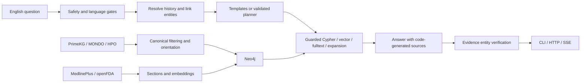

# Architecture

The English baseline separates ingestion, guarded graph retrieval, planning, answer composition, and external evaluation. Text retrieval and answer verification extend the baseline in phase 3. The public boundary is `ask(question, history)` over HTTP; evaluation never imports QA internals.

Synthetic CI evidence and real-data research measurements are reported separately. Neither establishes clinical effectiveness.
